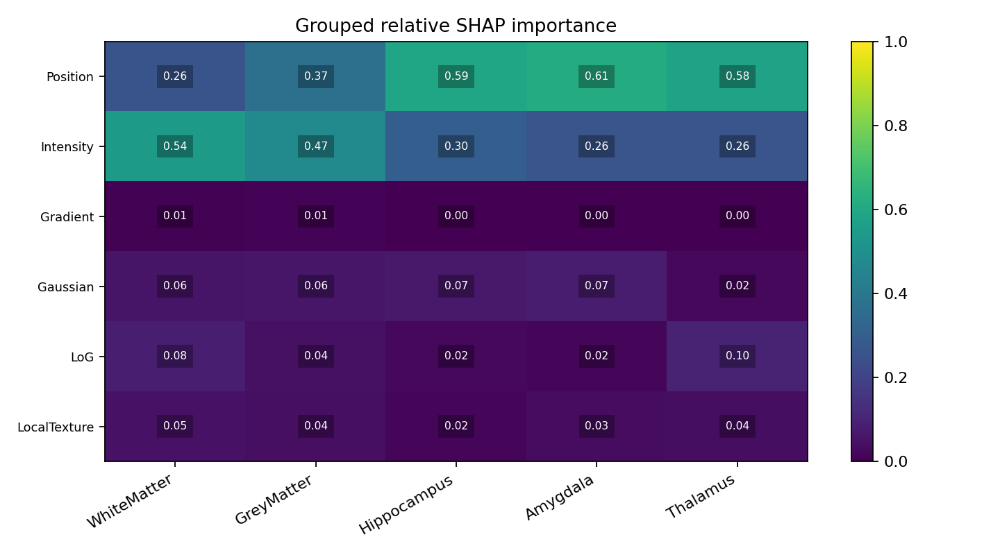
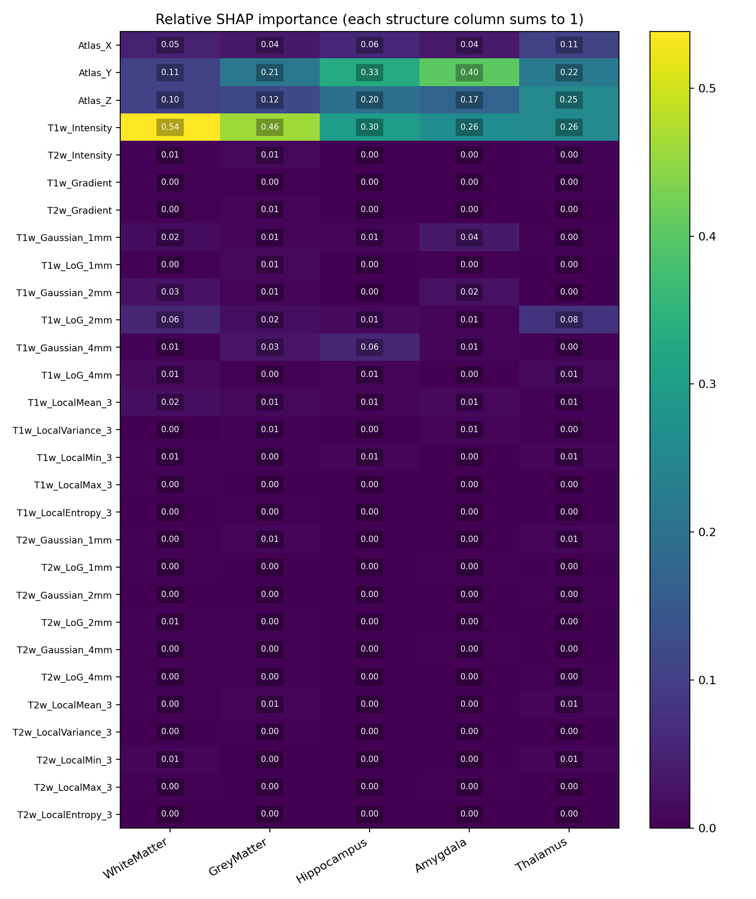
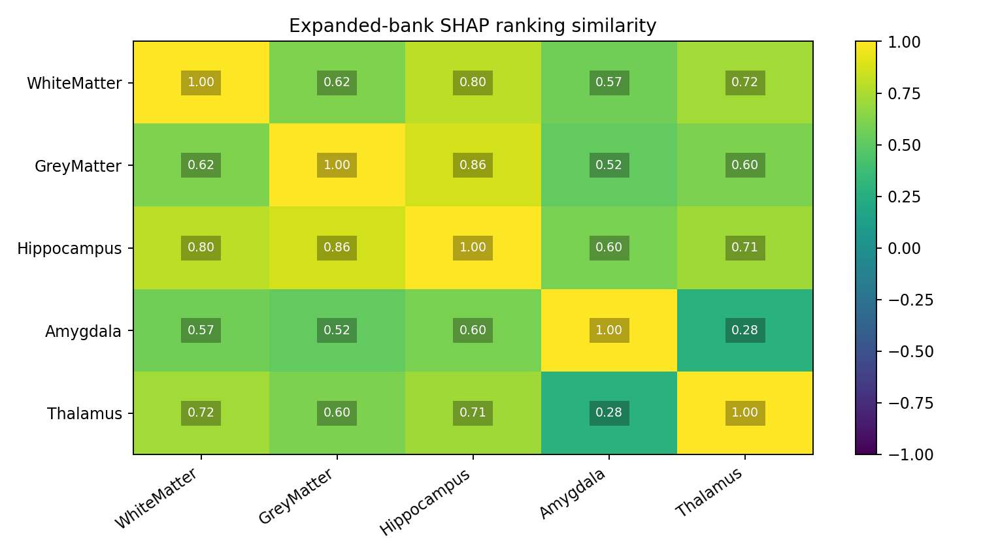
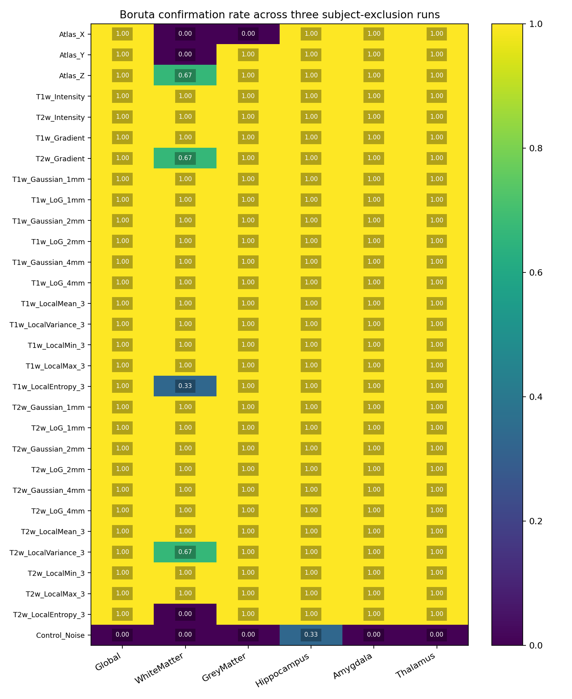

# Expanded features and training-subject stability

## Scope

29 candidate features were sampled at the exact same 99,446 training voxels
as the original 15-subject baseline. No validation or official test images
were loaded for this stage. Preprocessing and the six original columns are unchanged.

The expanded bank adds T2 gradient, Gaussian and scale-normalized LoG filters
at 1/2/4 mm, and local mean, variance, min, max and histogram entropy for T1/T2.
Entropy uses 16 fixed bins over normalized intensities [-3, 3]; values outside
that range are clipped. All local filters use reflect padding and a 3x3x3 window.

## SHAP

The rich multiclass RF uses the baseline settings (42 trees, depth 10).
Mean absolute SHAP contributions to each output class are computed over a
balanced training explanation sample, not just voxels of that true class.

## Subject stability

Boruta is fit on all 15 training subjects and on three 10-subject subsets.
Each subset excludes a different group of five subjects. The seed (42),
sample budgets and Boruta parameters are fixed across subject regimes.
The subsets overlap, so the three confirmation rates are descriptive, not
independent replications or confidence intervals.

Stable selection requires confirmation in full training and all three subsets.
This rule was fixed before running selection. One Gaussian noise column is
added only to Boruta as a diagnostic, never as a segmentation candidate.

The noise control was confirmed in 1 of 24 selection runs.

| Target | Stable feature count | Features |
| --- | ---: | --- |
| Global | 29 | Atlas_X, Atlas_Y, Atlas_Z, T1w_Intensity, T2w_Intensity, T1w_Gradient, T2w_Gradient, T1w_Gaussian_1mm, T1w_LoG_1mm, T1w_Gaussian_2mm, T1w_LoG_2mm, T1w_Gaussian_4mm, T1w_LoG_4mm, T1w_LocalMean_3, T1w_LocalVariance_3, T1w_LocalMin_3, T1w_LocalMax_3, T1w_LocalEntropy_3, T2w_Gaussian_1mm, T2w_LoG_1mm, T2w_Gaussian_2mm, T2w_LoG_2mm, T2w_Gaussian_4mm, T2w_LoG_4mm, T2w_LocalMean_3, T2w_LocalVariance_3, T2w_LocalMin_3, T2w_LocalMax_3, T2w_LocalEntropy_3 |
| WhiteMatter | 22 | T1w_Intensity, T2w_Intensity, T1w_Gradient, T1w_Gaussian_1mm, T1w_LoG_1mm, T1w_Gaussian_2mm, T1w_LoG_2mm, T1w_Gaussian_4mm, T1w_LoG_4mm, T1w_LocalMean_3, T1w_LocalVariance_3, T1w_LocalMin_3, T1w_LocalMax_3, T2w_Gaussian_1mm, T2w_LoG_1mm, T2w_Gaussian_2mm, T2w_LoG_2mm, T2w_Gaussian_4mm, T2w_LoG_4mm, T2w_LocalMean_3, T2w_LocalMin_3, T2w_LocalMax_3 |
| GreyMatter | 28 | Atlas_Y, Atlas_Z, T1w_Intensity, T2w_Intensity, T1w_Gradient, T2w_Gradient, T1w_Gaussian_1mm, T1w_LoG_1mm, T1w_Gaussian_2mm, T1w_LoG_2mm, T1w_Gaussian_4mm, T1w_LoG_4mm, T1w_LocalMean_3, T1w_LocalVariance_3, T1w_LocalMin_3, T1w_LocalMax_3, T1w_LocalEntropy_3, T2w_Gaussian_1mm, T2w_LoG_1mm, T2w_Gaussian_2mm, T2w_LoG_2mm, T2w_Gaussian_4mm, T2w_LoG_4mm, T2w_LocalMean_3, T2w_LocalVariance_3, T2w_LocalMin_3, T2w_LocalMax_3, T2w_LocalEntropy_3 |
| Hippocampus | 29 | Atlas_X, Atlas_Y, Atlas_Z, T1w_Intensity, T2w_Intensity, T1w_Gradient, T2w_Gradient, T1w_Gaussian_1mm, T1w_LoG_1mm, T1w_Gaussian_2mm, T1w_LoG_2mm, T1w_Gaussian_4mm, T1w_LoG_4mm, T1w_LocalMean_3, T1w_LocalVariance_3, T1w_LocalMin_3, T1w_LocalMax_3, T1w_LocalEntropy_3, T2w_Gaussian_1mm, T2w_LoG_1mm, T2w_Gaussian_2mm, T2w_LoG_2mm, T2w_Gaussian_4mm, T2w_LoG_4mm, T2w_LocalMean_3, T2w_LocalVariance_3, T2w_LocalMin_3, T2w_LocalMax_3, T2w_LocalEntropy_3 |
| Amygdala | 29 | Atlas_X, Atlas_Y, Atlas_Z, T1w_Intensity, T2w_Intensity, T1w_Gradient, T2w_Gradient, T1w_Gaussian_1mm, T1w_LoG_1mm, T1w_Gaussian_2mm, T1w_LoG_2mm, T1w_Gaussian_4mm, T1w_LoG_4mm, T1w_LocalMean_3, T1w_LocalVariance_3, T1w_LocalMin_3, T1w_LocalMax_3, T1w_LocalEntropy_3, T2w_Gaussian_1mm, T2w_LoG_1mm, T2w_Gaussian_2mm, T2w_LoG_2mm, T2w_Gaussian_4mm, T2w_LoG_4mm, T2w_LocalMean_3, T2w_LocalVariance_3, T2w_LocalMin_3, T2w_LocalMax_3, T2w_LocalEntropy_3 |
| Thalamus | 29 | Atlas_X, Atlas_Y, Atlas_Z, T1w_Intensity, T2w_Intensity, T1w_Gradient, T2w_Gradient, T1w_Gaussian_1mm, T1w_LoG_1mm, T1w_Gaussian_2mm, T1w_LoG_2mm, T1w_Gaussian_4mm, T1w_LoG_4mm, T1w_LocalMean_3, T1w_LocalVariance_3, T1w_LocalMin_3, T1w_LocalMax_3, T1w_LocalEntropy_3, T2w_Gaussian_1mm, T2w_LoG_1mm, T2w_Gaussian_2mm, T2w_LoG_2mm, T2w_Gaussian_4mm, T2w_LoG_4mm, T2w_LocalMean_3, T2w_LocalVariance_3, T2w_LocalMin_3, T2w_LocalMax_3, T2w_LocalEntropy_3 |

## Interpretation limits

Different selected sets or SHAP weights do not establish improved segmentation.
A matched validation experiment using the frozen selected sets is still needed.
Global multiclass and per-label binary selectors use different target tasks
and sample compositions. Correlated features may all be genuinely relevant.
The negative control is diagnostic and does not guarantee correct selection.
No selection threshold was changed in response to these results.

## Reproducibility

- [Configuration](./config.json)
- [Subject regimes](./subject_splits.json)
- [Individual Boruta decisions](./boruta_subject_runs.csv)
- [Subject stability table](./boruta_subject_stability.csv)
- [Stable sets](./selected_features.json)
- [Stable-set Jaccard overlaps](./stable_set_jaccard.csv)
- [Within-target subset overlaps](./subject_subset_jaccard.csv)
- [SHAP table](./shap_importance.csv)
