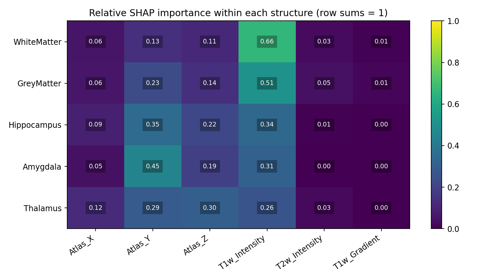
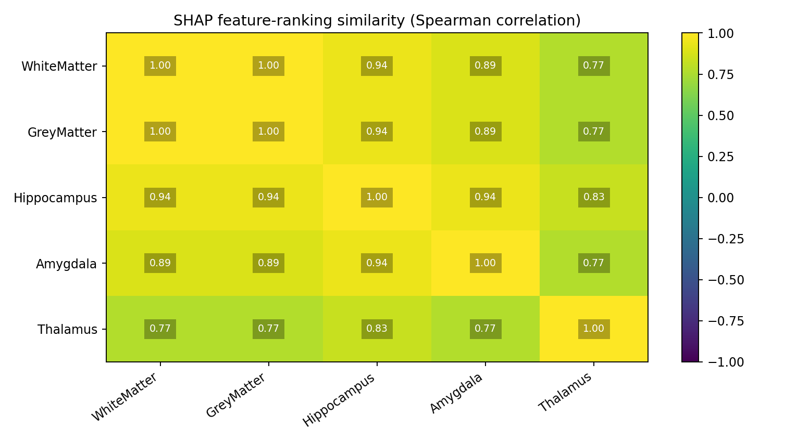
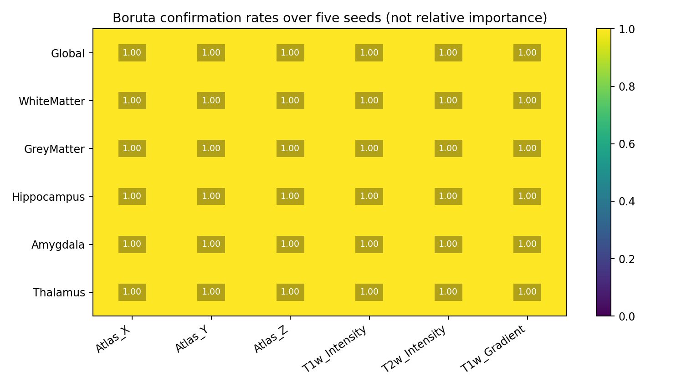

# Training-only feature analysis

Source: the 15 training subjects from the controlled T2 ablation.
No validation or official test voxels are used to fit or select features.

## SHAP

SHAP explains a refitted six-feature baseline with the saved RF settings.
Contributions to each class output are averaged in absolute value over
a balanced explanation sample of up to 500 voxels per true class.
This is not an average restricted to voxels of the target structure.

## Repeated Boruta

Each anatomical structure is classified against all other labels, including
background. Global selection uses the six-class problem. Both use five
seeds. Stable sets require confirmation in at least four of five runs.

| Target | Stable confirmed features |
| --- | --- |
| Global | Atlas_X, Atlas_Y, Atlas_Z, T1w_Intensity, T2w_Intensity, T1w_Gradient |
| WhiteMatter | Atlas_X, Atlas_Y, Atlas_Z, T1w_Intensity, T2w_Intensity, T1w_Gradient |
| GreyMatter | Atlas_X, Atlas_Y, Atlas_Z, T1w_Intensity, T2w_Intensity, T1w_Gradient |
| Hippocampus | Atlas_X, Atlas_Y, Atlas_Z, T1w_Intensity, T2w_Intensity, T1w_Gradient |
| Amygdala | Atlas_X, Atlas_Y, Atlas_Z, T1w_Intensity, T2w_Intensity, T1w_Gradient |
| Thalamus | Atlas_X, Atlas_Y, Atlas_Z, T1w_Intensity, T2w_Intensity, T1w_Gradient |

All targets select the same stable feature set. This analysis does not
provide evidence for different Boruta-selected sets across structures.
Do not force feature rejection to obtain the desired hypothesis.

## Limits and next experiments

Repeated voxel samples and RF seeds measure algorithmic sampling stability,
not stability across subjects. Subject-level resampling is still needed.
Global and binary selectors use different tasks and sample composition.
Confirmed features are not necessarily equally important: Boruta rank 1
denotes confirmation, not a shared effect size.
SHAP and Boruta do not establish that selected-feature models segment better.
A matched segmentation comparison is a separate experiment; when all sets
are identical, changing from multiclass to binary models would confound
feature selection with model architecture.

## Files

- [Configuration](./config.json)
- [SHAP importance values](./shap_importance.csv)
- [Spearman ranking correlations](./shap_spearman.csv)
- [Individual Boruta runs](./boruta_runs.csv)
- [Boruta stability summary](./boruta_stability.csv)
- [Stable feature sets](./selected_features.json)
- [Feature-set overlap](./boruta_jaccard.csv)
