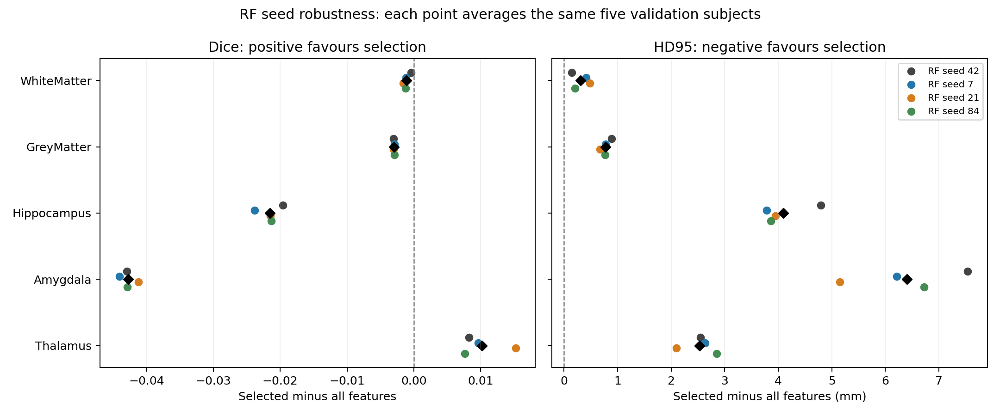

# RF-seed robustness of frozen label-specific selection

3 new RF seeds are compared with the existing seed-42 reference on
the same 15 training and five exploratory validation subjects. Training
rows, selected columns, 42 trees, depth 10 and raw OVR argmax are fixed.
Feature selection is not rerun and validation filters are computed only
once per subject, then reused for all new seeds.

## Mean Dice across seeds and the same five subjects

| Structure | OVR all 29 | OVR selected | Mean difference | Seed mean differences favouring selection |
| --- | ---: | ---: | ---: | ---: |
| WhiteMatter | 0.8286 | 0.8275 | -0.0011 | 0/4 |
| GreyMatter | 0.7186 | 0.7156 | -0.0030 | 0/4 |
| Hippocampus | 0.3970 | 0.3754 | -0.0215 | 0/4 |
| Amygdala | 0.5272 | 0.4844 | -0.0428 | 0/4 |
| Thalamus | 0.7061 | 0.7163 | +0.0102 | 4/4 |

## Dice difference by RF seed

| Structure | 42 | 7 | 21 | 84 |
| --- | ---: | ---: | ---: | ---: |
| WhiteMatter | -0.0004 | -0.0012 | -0.0016 | -0.0013 |
| GreyMatter | -0.0031 | -0.0029 | -0.0030 | -0.0029 |
| Hippocampus | -0.0196 | -0.0238 | -0.0214 | -0.0213 |
| Amygdala | -0.0430 | -0.0440 | -0.0412 | -0.0429 |
| Thalamus | +0.0083 | +0.0096 | +0.0152 | +0.0076 |

## HD95 (mm; lower is better)

| Structure | OVR all 29 | OVR selected | Mean difference | Seed means favouring selection |
| --- | ---: | ---: | ---: | ---: |
| WhiteMatter | 2.67 | 2.98 | +0.31 | 0/4 |
| GreyMatter | 2.94 | 3.72 | +0.77 | 0/4 |
| Hippocampus | 16.34 | 20.44 | +4.10 | 0/4 |
| Amygdala | 19.23 | 25.64 | +6.41 | 0/4 |
| Thalamus | 18.60 | 21.13 | +2.53 | 0/4 |

## Interpretation limits

Each plotted point is one seed's mean paired difference over the same
five subjects. These are 4 algorithmic repetitions, not new
independent subjects. Seed variation does not measure population uncertainty.
No significance claim is made. This split remains exploratory; two subjects
were inspected in the smoke check. The official test set remains unused.
Only RF randomness changes statistically. New runs use 4 worker threads
and contiguous input blocks for efficiency; the reference used 2 workers.
Raw OVR probabilities remain uncalibrated and no class-prior correction
is applied. White/grey-matter scores compete with unchanged class models.
No subsets, sampling rows or hyperparameters were changed after seeing
the seed-42 result. The auxiliary multiclass model is not repeated.

## Files

- [Configuration and source hashes](./config.json)
- [All scores, including the reused reference](./all_seed_scores.csv)
- [Per-seed scores and subject variability](./per_seed_summary.csv)
- [Per-subject paired differences](./subject_seed_deltas.csv)
- [Per-seed mean differences](./per_seed_deltas.csv)
- [Robustness summary](./seed_robustness_summary.csv)
