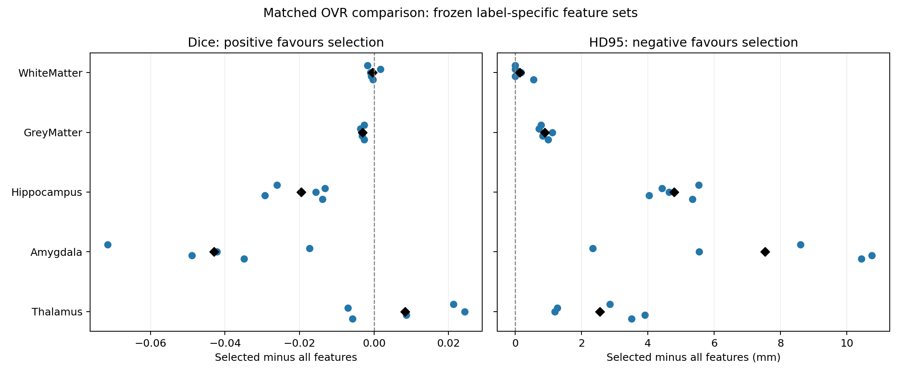

# Frozen label-specific selection: matched validation

All strategies use the same 15 training subjects, sampled rows and five
exploratory validation subjects. The official test set remains unused.

## Comparison

The primary comparison is six one-vs-rest Random Forests using all 29 inputs
versus six RFs with frozen per-label subsets. Both use 42 trees, depth 10,
the same seed, no class weighting and the same training rows. Only white- and
grey-matter input columns differ. Background retains all inputs. Identical
class models are reused, so their scores are exactly equal across strategies.
A 29-feature multiclass RF is an auxiliary architecture reference.

## Mean Dice

| Structure | Features selected | Multiclass 29 | OVR all 29 | OVR selected | Selected minus all | Improved subjects |
| --- | ---: | ---: | ---: | ---: | ---: | ---: |
| WhiteMatter | 22 | 0.8337 | 0.8284 | 0.8280 | -0.0004 | 1/5 |
| GreyMatter | 28 | 0.7125 | 0.7191 | 0.7160 | -0.0031 | 0/5 |
| Hippocampus | 29 | 0.3612 | 0.3973 | 0.3777 | -0.0196 | 0/5 |
| Amygdala | 29 | 0.4493 | 0.5270 | 0.4840 | -0.0430 | 0/5 |
| Thalamus | 29 | 0.7178 | 0.7050 | 0.7133 | +0.0083 | 3/5 |

## Mean HD95 (mm; lower is better)

| Structure | Multiclass 29 | OVR all 29 | OVR selected |
| --- | ---: | ---: | ---: |
| WhiteMatter | 3.09 | 2.74 | 2.89 |
| GreyMatter | 3.27 | 2.86 | 3.74 |
| Hippocampus | 17.55 | 16.28 | 21.08 |
| Amygdala | 15.65 | 18.03 | 25.57 |
| Thalamus | 7.53 | 18.92 | 21.47 |

## Limits

The binary RF scores are raw probabilities, not calibrated posteriors and
need not sum to one. No class-prior correction is applied for the original
class-dependent voxel sampling. The same combination rule is used in both
OVR strategies, so this is a controlled comparison of these implementations,
not a claim that the OVR combination is optimal.
Unchanged class scores can still yield different segmentations because
white/grey-matter scores compete with all other classes in the argmax.
This is one RF seed and an exploratory five-subject split, not an independent
final test or evidence of statistical significance. Two validation subjects
were previously inspected in the initial smoke check. No validation result
was used to change the frozen subsets during this experiment.

## Files

- [Configuration](./config.json)
- [Per-subject scores](./validation_scores.csv)
- [Means and population standard deviations](./validation_summary.csv)
- [Paired OVR differences](./paired_selection_deltas.csv)
- [Processing times](./subject_timings.csv)
