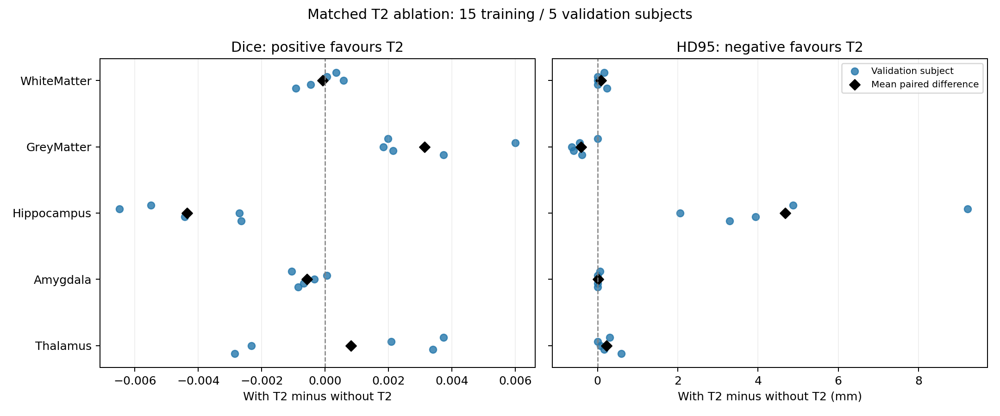

# Controlled T2 ablation: exploratory validation

Both models were trained on the same 15 subjects and evaluated on the same
five validation subjects. The official ten-subject test set was not used.
Two validation subjects had appeared in the earlier smoke check, so this
is an exploratory comparison, not an untouched final evaluation.

## Mean validation scores

| Structure | Dice with T2 | Dice without T2 | Mean Dice difference | Subjects with improved Dice | HD95 with T2 (mm) | HD95 without T2 (mm) |
| --- | ---: | ---: | ---: | ---: | ---: | ---: |
| WhiteMatter | 0.8355 | 0.8356 | -0.0001 | 3/5 | 2.39 | 2.31 |
| GreyMatter | 0.7103 | 0.7072 | +0.0031 | 5/5 | 3.43 | 3.84 |
| Hippocampus | 0.3262 | 0.3305 | -0.0044 | 0/5 | 24.28 | 19.60 |
| Amygdala | 0.4450 | 0.4456 | -0.0006 | 1/5 | 15.74 | 15.73 |
| Thalamus | 0.7292 | 0.7284 | +0.0008 | 3/5 | 6.78 | 6.55 |

## Paired differences

All differences are with T2 minus without T2. Positive Dice differences
and negative HD95 differences favour T2. Each dot represents one
validation subject; black diamonds show the mean paired difference.

## Interpretation limits

This is one fixed subject split and one Random Forest seed. No statistical
significance claim is made. T2 ablation does not test whether label-specific
feature selection improves segmentation; that is a separate experiment.

## Reproducibility

- [Configuration and source provenance](./config.json)
- [Subject split](./split.json)
- [Per-subject scores](./validation_scores.csv)
- [Means and population standard deviations](./validation_summary.csv)
- [Paired differences](./paired_t2_deltas.csv)
- [Exact runner snapshot](./runner_snapshot.py)
